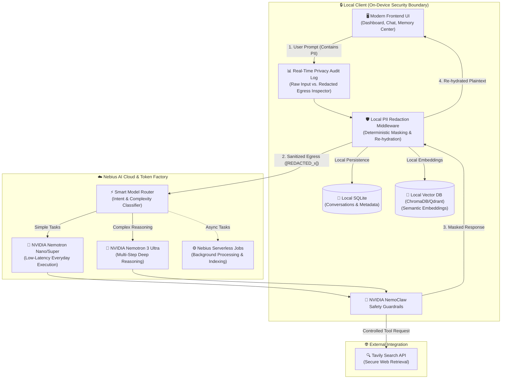

# 🛡️ RecallOS — Privacy-First Personal AI with Persistent Memory

[](https://github.com)
[](https://nebius.com)
[](https://developer.nvidia.com)
[](LICENSE)
[](https://github.com)

> **Built for the Nebius × NVIDIA Global AI Hackathon 2026**  
> *"Build an always-on, private assistant that works for you while keeping your data under your control."*

---

## 🌟 Executive Summary

**RecallOS** is an intelligent, always-on personal AI companion engineered with a **verifiable privacy-first architecture** and **long-term persistent memory**. 

Unlike conventional AI chatbots that forget your history, require copy-pasting repetitive context, or transmit raw sensitive personal information to cloud servers, RecallOS:
1. **Never leaks unredacted PII to the cloud** via client-side deterministic tokenization.
2. **Maintains structured long-term memory** across projects, conversations, and restarts.
3. **Smart-routes reasoning** dynamically between **NVIDIA Nemotron Nano/Super** (for instant, low-latency daily tasks) and **Nemotron 3 Ultra** (for multi-step complex workflows) powered by **Nebius Token Factory**.
4. **Guarantees user sovereignty** with an interactive **Real-Time Privacy Audit Log**, source-grounded memory evidence, and strict approval barriers before executing consequential agent actions.

---

## 🏗️ System Architecture



---

## 💎 Core Differentiators & Winning Features

### 1. 🛡️ Verifiable Privacy & Local-First Shield
* **Client-Side Interceptors**: Names, phone numbers, email addresses, financial tokens, and credentials are scrubbed locally on your machine before network packets leave your device.
* **Deterministic Masking & Re-hydration**: Egress text transforms entities into tokens like `[REDACTED_NAME_1]` or `[REDACTED_FINANCIAL_ORG_1]`. Upon model response, the client-side engine re-hydrates tokens seamlessly without the cloud ever seeing private data.
* **Zero Cloud Memory**: Raw embeddings and memory stores reside strictly in your local ChromaDB / Qdrant instance.

### 2. ⚡ Dynamic Smart Routing on Nebius Token Factory
* **Efficiency & Cost Optimization**: Automatically assesses prompt complexity. Simple queries, summarizations, and daily commands route to **NVIDIA Nemotron Nano/Super** (< 300ms latency).
* **Deep Reasoning Engine**: Strategic decision-making, code generation, and complex planning escalate to **NVIDIA Nemotron 3 Ultra**.

### 3. 🧠 Selective, Persistent Memory (Not Just a Chat History)
* **Automatic Extraction**: Structures messages into durable facts, preferences, goals, and decisions.
* **Semantic Retrieval with Visible Citations**: Answers display an interactive *"Based on these memories"* badge, showing exact source timestamps and references.
* **Conflict Resolution**: Prevents obsolete facts from silently corrupting context (e.g., updating learning status from *"Learning Python"* to *"Building in Rust"*).

### 4. 🎛️ Real-Time Privacy Audit Log (Hero UI Feature)
* A live observability drawer for judges and privacy-conscious users displaying:
  * **Column A**: Raw, un-sanitized user prompt.
  * **Column B**: Sanitized egress payload passed to Nebius API endpoints.
  * **Column C**: Model allocation metadata (Model type, Latency ms, Token consumption, PII items guarded).

### 5. 🤖 Controlled Agent Actions & NemoClaw Guardrails
* The agent cannot run unverified database modifications or harmful operations.
* Consequential actions (updating project status, saving memories, deleting entries) require explicit **Human-in-the-Loop Approval Dialogs**.

---

## 🗺️ Application Roadmap & Routes

| Route | View Name | Key Capabilities |
| :--- | :--- | :--- |
| `/dashboard` | **Personal Dashboard** | Active projects, urgent tasks, recent memory timeline, quick-access chat |
| `/chat` | **AI Chat & Copilot** | Memory-grounded responses, cited evidence chips, agent action approval cards |
| `/memories` | **Memory Control Center** | Search, semantic filter, inspect, edit, manually insert, or delete memories |
| `/projects` | **Project Workspace** | Structured goals, AI task breakdowns, milestone trackers, linked conversations |
| `/audit` | **Privacy Audit Panel** | Real-time observability: Raw input vs. Sanitized Egress vs. Token Factory dispatch |
| `/settings` | **Privacy & Security** | Conversation-only toggle, memory retention rules, export data JSON, purge DB |
| `/evaluation` | **Benchmark Suite** | Recall@k evaluation, latency meters, zero-PII leak validation test cases |

---

## 📂 Repository Structure

```plaintext
RECALLOS/
├── docs/                        # Complete architecture specs, pitch scripts, and guides
├── frontend/                    # Modern Client Dashboard (Next.js / React + Tailwind CSS)
│   ├── src/
│   │   ├── components/          # AppSidebar, ChatPanel, MemoryCard, AuditDrawer, etc.
│   │   ├── hooks/               # useMemory, usePrivacyShield, useChatStream
│   │   ├── pages/ (or app/)     # Dashboard, Chat, Memories, Projects, Settings, Audit
│   │   └── styles/              # Design system tokens & Tailwind configurations
│   └── package.json
├── backend/                     # FastAPI Orchestration Engine
│   ├── app/
│   │   ├── api/                 # Endpoints for chat, memories, projects, and tasks
│   │   ├── core/                # Nebius Token Factory client & config
│   │   ├── models/              # SQLite / Pydantic database schemas
│   │   └── services/            # Intent router & context assemblers
│   ├── requirements.txt
│   └── main.py
├── privacy_engine/              # Client-Side Security Layer
│   ├── scrubber.py / .ts        # PII detection & deterministic token replacer
│   ├── rehydrator.py / .ts      # Response token re-hydrator
│   └── local_store/             # ChromaDB / Qdrant vector storage interfaces
├── agent_core/                  # Hermes Agent / OpenShell Tool Framework
│   ├── tools/                   # Local file search, calendar, finance, Tavily search
│   └── guardrails/              # NVIDIA NemoClaw safety boundaries
└── evaluation/                  # Automated Benchmark & Quality Evaluation Suite
    ├── test_retrieval.py        # Recall@k & accuracy tests
    └── test_pii_isolation.py    # Zero-leakage verification checks
```

---

## 👥 Team Roles & Hackathon Execution

| Role | Lead | Focus Areas |
| :--- | :--- | :--- |
| **Member 1** | **AI & Model Lead** | Nebius infrastructure, API endpoint integration, latency benchmarking, Smart Model Router (Nemotron Nano vs. Ultra), Nebius Serverless Jobs. |
| **Member 2** | **Agent & Tools Developer** | Hermes Agent / OpenShell execution loop, core skills (local filesystem indexing, calendar, finance tracking), Tavily search integration ($3,000 bonus). |
| **Member 3** | **Privacy & Memory Lead** | Local PII scrubber middleware, ChromaDB/Qdrant local persistent vector memory, NVIDIA NemoClaw safety guardrails. |
| **Member 4** | **Frontend, Integration & Pitch Lead** | Client dashboard, Real-time Privacy Audit panel, end-to-end integration, documentation, and the final 3-minute pitch video production. |

---

## 🎬 Hackathon 3-Minute Demo Script & Narrative

* **0:00 - 0:30 (The Problem)**: The dilemma of modern AI—users need an assistant that remembers context, but cloud memory exposes confidential identities, credentials, and financial data.
* **0:30 - 1:15 (The Solution & Core Memory)**:
  1. *Create Project*: User sets up a project with goals and deadlines.
  2. *Session Persistence*: Close the app, restart, and launch a fresh session.
  3. *Context Recall*: Ask a question—RecallOS retrieves past facts with clickable evidence chips (*"Based on these memories"*).
* **1:15 - 2:00 (Verifiable Privacy in Action)**:
  4. *Privacy Audit*: Open the Real-Time Audit drawer. Type a message with a phone number and bank account.
  5. *Sanitization*: Show live token substitution to `[REDACTED_PHONE_1]` before dispatching to **Nebius Token Factory**.
  6. *Smart Routing*: Show badge indicating prompt routed to **NVIDIA Nemotron Nano** or **3 Ultra**.
* **2:00 - 2:30 (Controlled Agent Action & NemoClaw Guardrails)**:
  7. *Approval Dialog*: Agent suggests creating a project task; user reviews and approves before state updates.
* **2:30 - 3:00 (Evaluation & Wrap-Up)**:
  8. Demonstrate test benchmarks (high Recall@k, zero PII leakage) and closing pitch.

---

## 🚀 Getting Started

### Prerequisites
* **Python**: 3.10+
* **Node.js**: 18.0+
* **Nebius Cloud API Key**: configured for Nebius Token Factory
* **Tavily API Key**: for secure web search

### 1. Clone & Set Up Environment
```bash
git clone https://github.com/your-org/recallos.git
cd recallos
```

### 2. Backend & Privacy Engine Setup
```bash
cd backend
python -m venv venv
source venv/bin/activate  # On Windows: venv\Scripts\activate
pip install -r requirements.txt
cp .env.example .env      # Add Nebius & Tavily credentials
python main.py
```

### 3. Frontend Dashboard Setup
```bash
cd ../frontend
npm install
npm run dev
```
Open [http://localhost:3000](http://localhost:3000) to view the RecallOS Dashboard and Privacy Audit Log.

---

## ⚖️ Open Source License & Compliance
This project is licensed under the **MIT License** — see the [LICENSE](LICENSE) file for details. Built in full compliance with the Nebius × NVIDIA Global AI Hackathon requirements.
